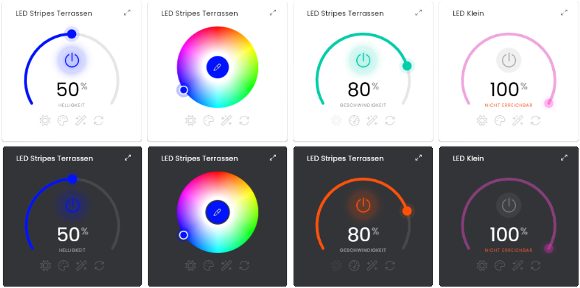

# 🌈 Magic Home Controller

[](https://wilkware.de/module/mhc/)
[](https://www.symcon.de/service/dokumentation/entwicklerbereich/sdk-tools/sdk-php/)
[](https://www.symcon.de/produkt/)
[](https://github.com/Wilkware/MagicHomeController)
[](https://creativecommons.org/licenses/by-nc-sa/4.0/)
[](https://github.com/Wilkware/MagicHomeController/actions)

Ermöglicht die Ansteuerung von WiFi LED Controllern der Firma _Magic Home_.



## Inhaltverzeichnis

1. [Funktionsumfang](#user-content-1-funktionsumfang)
2. [Voraussetzungen](#user-content-2-voraussetzungen)
3. [Installation](#user-content-3-installation)
4. [Einrichtung](#user-content-4-einrichtung)
5. [Statusvariablen](#user-content-5-statusvariablen)
6. [Darstellungen](#user-content-6-darstellungen)
7. [Visualisierung](#user-content-7-visualisierung)
8. [Befehlsreferenz](#user-content-8-befehlsreferenz)
9. [Versionshistorie](#user-content-9-versionshistorie)

### 1. Funktionsumfang

Das Modul dient zur Ansteuerung von LED Stripes mittels eines WiFi LED Controllers des Herstellers Magic Home.

* Ein- und Ausschalten des Controllers
* Einstellen von Farbe, Helligkeit und Geschwindigkeit
* Auswahl von vordefinierten Mustern bzw. Effekten (abhängig vom Controller-Typ)
* Auslesen des aktuellen Controller-Zustands (Synchronisieren)
* Steuerung über die Statusvariablen oder eine eigene Kachel (TileVisu)

Folgende Controller werden unterstützt (Typ = Kennung des Controllers, wie sie auch die Gerätesuche anzeigt):

Typ  | Bezeichnung               | Effekte        | Helligkeit im Effekt
---- | ------------------------- | -------------- | --------------------
0x01 | Original LEDENET          | Voreingestellt | –
0x04 | UFO LED WiFi Controller   | Voreingestellt | –
0x06 | RGBW Controller           | Voreingestellt | ✓
0x07 | RGBCW Controller          | Voreingestellt | ✓
0x08 | RGB Controller with MIC   | Voreingestellt | ✓
0x09 | CCT Ceiling Light         | Voreingestellt | –
0x0B | Smart Switch 1c           | – (Schalter)   | –
0x0E | Floor Lamp                | Voreingestellt | –
0x10 | Christmas Light           | Voreingestellt | –
0x16 | Magnetic Light CCT        | Voreingestellt | –
0x17 | Magnetic Light Dimable    | Voreingestellt | –
0x18 | Plant Light               | Voreingestellt | –
0x19 | Smart Socket 2 USB        | – (Schalter)   | –
0x1A | Christmas Light           | Voreingestellt | –
0x1B | Spray Light               | Voreingestellt | –
0x1C | Table Light CCT           | Voreingestellt | –
0x21 | Smart Bulb Dimmable       | Voreingestellt | –
0x25 | RGB/WW/CW Controller      | Voreingestellt | –
0x33 | RGB Controller            | Voreingestellt | –
0x35 | Smart Bulb RGBCW          | Voreingestellt | –
0x41 | Single Channel Controller | Voreingestellt | –
0x44 | Smart Bulb RGBW           | Voreingestellt | –
0x45 | Unbekanntes Modell        | Voreingestellt | –
0x52 | Smart Bulb CCT            | Voreingestellt | –
0x54 | Downlight RGBW            | Voreingestellt | –
0x62 | CCT Controller            | Voreingestellt | –
0x81 | Unbekanntes Modell        | Voreingestellt | –
0x93 | Smart Switch 1C           | – (Schalter)   | –
0x94 | Smart Switch 1c Watt      | – (Schalter)   | –
0x95 | Smart Switch 2c           | – (Schalter)   | –
0x96 | Smart Switch 4c           | – (Schalter)   | –
0x97 | Smart Socket 1c           | – (Schalter)   | –
0xA1 | RGB Symphony v1           | Original       | –
0xA2 | RGB Symphony v2           | Adressierbar   | ✓
0xA3 | RGB Symphony v3           | Adressierbar   | ✓
0xD1 | Digital Light             | Voreingestellt | –
0xE1 | Ceiling Light             | Voreingestellt | –
0xE2 | Ceiling Light Assist      | Voreingestellt | –

_Effekte_: Umfang der auswählbaren Muster bzw. Effekte (siehe [Darstellungen](#user-content-6-darstellungen)).  
_Helligkeit im Effekt_: Nur bei diesen Controllern kann die Helligkeit auch während eines Effekts eingestellt werden.

Erfolgreiche Tests wurden mit den Controllern _'RGB Controller'_, _'RGB Symphony v1'_ und _'RGB Symphony v2'_ durchgeführt.
Weiterführende Möglichkeiten und Funktionen wie Warmweiß, Music usw. konnten aus Mangel an Hardware noch nicht implementiert werden.
Bei den 'Original'-Effekten wird nur eine Auswahl der 300 möglichen Modi unterstützt.

### 2. Voraussetzungen

* Symcon ab Version 8.1

### 3. Installation

* Über den Modul Store die Bibliothek _Magic Home Controller_ installieren.
* Alternativ über das Modul Control folgende URL hinzufügen.  
`https://github.com/Wilkware/MagicHomeController` oder `git://github.com/Wilkware/MagicHomeController.git`

### 4. Einrichtung

* Unter 'Instanz hinzufügen' ist das _Magic Home Controller_-Modul (Alias: _LED Wifi Controller_, _LED Strips Controller_) unter dem Hersteller 'Magic Home' aufgeführt.
* Alternativ können Instanzen bequem über die _Magic Home Discovery_ (Gerätesuche) angelegt werden.

__Konfigurationsseite__:

Die Konfiguration beinhaltet die Anzeige der Geräteinformationen (IP-Adresse usw.) und die Auswahl der Farbkanal-Reihenfolge (RGB-Pins).  
Die Reihenfolge der Pins beginnt immer ausgehend vom GND-Pin (12V Pin).

_Einstellungsbereich:_

> 📟 Geräteinformationen ...

Name               | Beschreibung
------------------ | ---------------------------------
Controller-Typ     | Typbezeichnung des Controllers
Controller-Modell  | Modellbezeichnung des Controllers
Controller-IP      | IP-Adresse des Controllers im lokalen WLAN (z.B. 192.168.0.10)
Controller-ID      | ID des Controllers (MAC-Adresse des Controllers)

> ⚙️ Erweiterte Einstellungen ...

Name               | Beschreibung
------------------ | ---------------------------------
RGB Pin Belegung   | Reihenfolge der Farb-Kanäle (Pins), Standard ist RGB

_Aktionsbereich:_

> 🧪 Test ...

Aktion             | Beschreibung
------------------ | ------------------------------------------------------------
Ein / Aus          | Ein- bzw. Ausschalten des Controllers
Synchronisieren    | Auslesen des internen Controller-Setups und Abgleich der betroffenen Statusvariablen
Modus              | Auswahl des Modus (manuell oder Muster/Effekt)
Farbe              | Einstellen des Farbwertes
Helligkeit         | Einstellen der Helligkeit
Geschwindigkeit    | Einstellen der Geschwindigkeit des Musters bzw. Effekts

### 5. Statusvariablen

Die Statusvariablen werden automatisch angelegt. Das Löschen einzelner kann zu Fehlfunktionen führen.

Ident      | Name            | Typ     | Beschreibung
---------- | --------------- | ------- | ------------------------------
Power      | Aktiv           | Boolean | Ein- bzw. Ausschalten des Controllers
Color      | Farbe           | Integer | Farbwert
Speed      | Geschwindigkeit | Integer | Geschwindigkeit des Musters bzw. Effekts
Brightness | Helligkeit      | Integer | Helligkeitswert
Mode       | Modus           | Integer | Manueller Farbmodus oder vordefinierter Funktionsmodus (Muster/Effekte)

### 6. Darstellungen

Die Darstellungen werden direkt an den Statusvariablen hinterlegt, es werden keine Profile angelegt.

Variable             | Darstellung   | Werte
-------------------- | ------------- | ------------------------------
Aktiv                | Schalter      | An / Aus
Farbe                | Farbe         | Farbwert (RGB)
Geschwindigkeit      | Schieberegler | 0 – 100 % (Schrittweite 1)
Helligkeit           | Schieberegler | 0 – 100 % (Schrittweite 1)
Modus                | Aufzählung    | abhängig vom Controller-Typ (siehe unten)

Die Werte der Variable 'Modus' richten sich nach dem Controller-Typ:

Muster               | Werte
-------------------- | ------------------------------
Voreingestellt       | Manuell (0), 20 voreingestellte Muster (37 – 56)
Original             | Manuell (0), 125 ausgewählte Effekte (1 – 300)
Adressierbar         | Manuell (0), 103 Effekte (1 – 102, 255)

### 7. Visualisierung

Man kann sowohl das gesamte Modul (HTML-SDK Support) als auch nur die Statusvariablen direkt in der Visualisierung verlinken.

Die Kachel ist an die Standard-Kacheln (z.B. Klimasteuerung) angelehnt und bündelt alle Funktionen des Controllers:

Element              | Beschreibung
-------------------- | ------------------------------
Bogenregler          | Helligkeit 0 – 100 % (im Effektmodus nur bei dimmbaren Effekten) bzw. Geschwindigkeit
Ein/Aus              | Schaltet den Controller ein bzw. aus (Mitte des Bogenreglers)
Farbrad              | Farbauswahl, die Mitte öffnet zusätzlich den Farbwähler (nur im Modus 'Manuell')
Helligkeit           | Zeigt den Bogenregler für die Helligkeit
Farbe/Geschwindigkeit| Zeigt das Farbrad (manuell) bzw. den Bogenregler für die Geschwindigkeit (Effekt)
Modus                | Auswahl zwischen manuellem Farbmodus und vordefinierten Mustern/Effekten
Synchronisieren      | Liest den aktuellen Zustand des Controllers aus

Ist der Controller nicht erreichbar, wird dies in der Kachel angezeigt und die Regler sind gesperrt.

### 8. Befehlsreferenz

```php
void MHC_SetBrightness(int $instanzID, int $brightness);
```

Setzt die Helligkeit auf $brightness. Die Funktion liefert keinerlei Rückgabewert.

```php
void MHC_SetColor(int $instanzID, int $color);
```

Setzt den Farbwert auf $color. Die Funktion liefert keinerlei Rückgabewert.

```php
void MHC_SetMode(int $instanzID, int $mode);
```

Setzt den Anzeigemodus auf $mode. Die Funktion liefert keinerlei Rückgabewert.

```php
void MHC_SetPower(int $instanzID, bool $power);
```

Schaltet den Controller ein (true) bzw. aus (false). Die Funktion liefert keinerlei Rückgabewert.

```php
void MHC_SetSpeed(int $instanzID, int $speed);
```

Setzt die Geschwindigkeit auf $speed. Die Funktion liefert keinerlei Rückgabewert.

### 9. Versionshistorie

v4.0.20261021

* _NEU_: Kompatibilität auf Symcon 8.1 hoch gesetzt
* _NEU_: Umstellung auf Darstellungen (keine Profile mehr)
* _NEU_: Kachel-Visualisierung (TileVisu)
* _NEU_: Testfunktionen im Aktionsbereich der Konfiguration
* _NEU_: Statusmeldungen für nicht erreichbaren Controller und unbekannten Controller-Typ
* _FIX_: Synchronisation von Farbe und Helligkeit korrigiert (u.a. Pinbelegung)
* _FIX_: Erkennung von Schaltern und Steckdosen beim Synchronisieren
* _FIX_: Übersetzung der Modi bleibt nach dem Übernehmen erhalten
* _FIX_: Werte werden bei fehlgeschlagener Übertragung zurückgesetzt
* _FIX_: Konfigurationsformular vereinheitlicht
* _FIX_: Interne Bibliotheken überarbeitet
* _FIX_: Dokumentation überarbeitet

v3.0.20221231

* _NEU_: Discovery Modul hinzugefügt
* _NEU_: Erkennen von 27 verschiedene Controllern
* _NEU_: Neues Profilehandling für Effekte (Mode)
* _NEU_: Auslesen des aktuellen Controller-Setups (Sync)
* _NEU_: Kompatibilität auf IPS 6.4 hoch gesetzt
* _FIX_: Pinbelegung der Farbkanäle erweitert und systemweit angewendet
* _FIX_: Controller Modul umbenannt

v2.0.20210701

* _NEU_: Konfigurationsformular vereinheitlicht
* _FIX_: Berechnung der Geschwindigkeit bei Programmen
* _FIX_: Code optimiert und Übersetzungen nachgezogen
* _FIX_: Interne Bibliotheken überarbeitet und vereinheitlicht
* _FIX_: Debug Meldungen überarbeitet
* _FIX_: Dokumentation überarbeitet

v1.2.20190812

* _NEU_: Anpassungen für Module Store
* _NEU_: Vereinheitlichungen, Umstellung auf Libs
* _FIX_: Fehler in Profilen korrigiert

v1.1.20190225

* _NEU_: Umbenennungen, Vereinheitlichungen, StyleCI uvm.

v1.0.20180415

* _NEU_: Initialversion

## Danksagung

Ich möchte mich für die Unterstützung bei der Entwicklung dieses Moduls bedanken bei ...

* _@Spoosie_ : Für die Basisarbeit in seinem Modul (KH\_LEDWiFiController)
* _@Thorsten79_ : Für die Unterstützung und Bereitstellung der 2 Controller (_'RGB Symphony v1'_ & _'RGB Symphony v2'_)
* _@Brutus_, _@lcnrookie_ und _@uwer_ : Für die Unterstützung als Tester

Vielen Dank für die hervorragende und tolle Arbeit!

## Entwickler

Seit nunmehr über 10 Jahren fasziniert mich das Thema Haussteuerung. In den letzten Jahren betätige ich mich auch intensiv in der Symcon Community und steuere dort verschiedenste Skript und Module bei. Ihr findet mich dort unter dem Namen @pitti ;-)

[](https://wilkware.github.io/)

## Spenden

Die Software ist für die nicht kommerzielle Nutzung kostenlos, über eine Spende bei Gefallen des Moduls würde ich mich freuen.

[](https://www.paypal.com/cgi-bin/webscr?cmd=_s-xclick&hosted_button_id=8816166)

## Lizenz

Namensnennung - Nicht-kommerziell - Weitergabe unter gleichen Bedingungen 4.0 International

[](https://creativecommons.org/licenses/by-nc-sa/4.0/)
